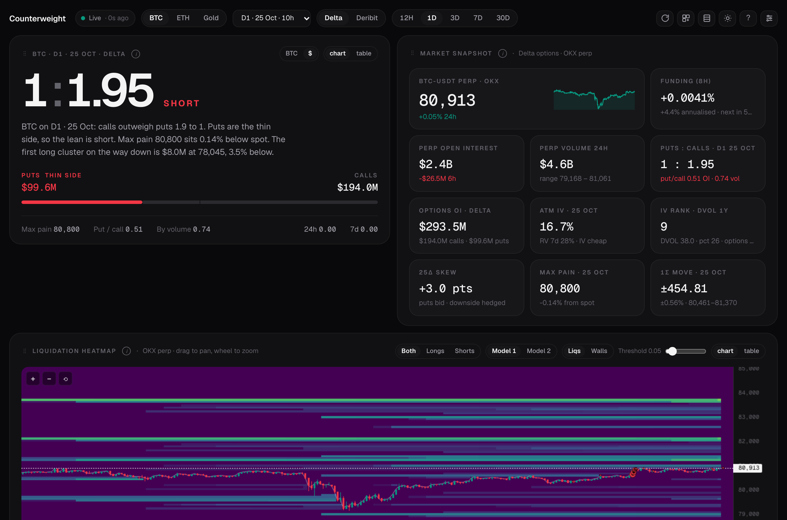
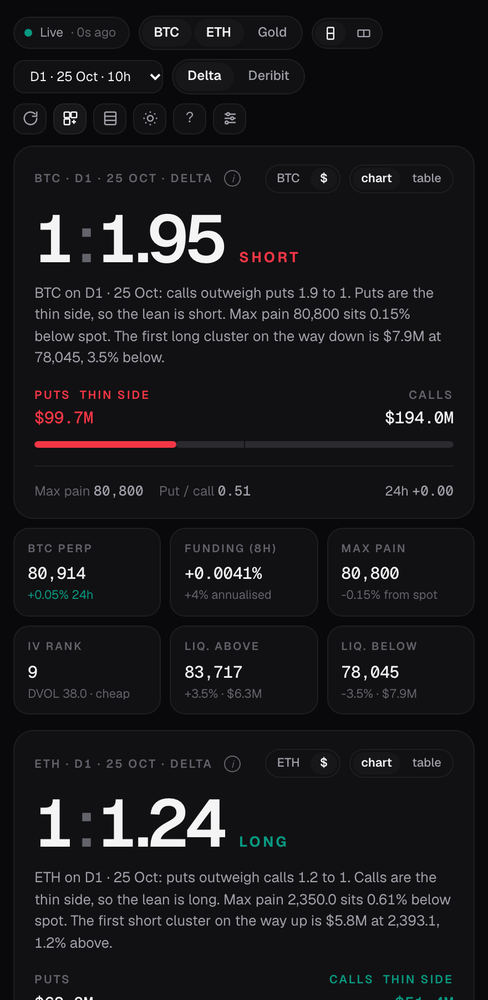

# Counterweight

**The thin side is the trade.** Options positioning and liquidation levels for BTC, ETH and gold, on one screen.
A put/call conviction ratio first, then an estimated liquidation heatmap, open interest and gamma by strike,
the volatility surface, options flow and alerts. Runs as a web app, an installable PWA, or a small
always-on-top desktop window. Public exchange data only: no accounts, no API keys, nothing leaves the browser.

[**Open the web app**](https://cryptodesk-anakeet.vercel.app) ·
[**Download for Windows / macOS**](https://github.com/anikeitvadi/cryptodesk/releases/latest) ·
[Architecture](docs/ARCHITECTURE.md) · [Changelog](CHANGELOG.md)



## What it shows

**Put / call, written as a lean.** The hero card is one number, one word and one sentence. The number has
the smaller side as 1, so `1 : 2.3` means 2.3× as much open interest on the bigger side. The word is the trade
direction and the only coloured thing on the card: **Short** in red when puts are the thin side (the crowd is long),
**Long** in green when calls are thin (the crowd is hedged). The sentence is the **Read**, composed from the
numbers on screen: the lean, max pain, the first liquidation cluster in the lean's direction, funding when it is
extreme. Under it, puts and calls with a single split bar, then max pain, the classic put/call figure, the
24h-volume ratio and the 24h / 7d change. The per-expiry breakdown is one tap away in the table view.

**Market snapshot.** Perp price and 24h change, funding (8h and annualised), perp open interest and its 6h
change, 24h volume, options open interest, ATM implied vs 7-day realised volatility, IV rank (1y), 25Δ skew,
max pain and the 1σ expected move for the front expiry.

**Liquidation heatmap.** A price × time map of where leveraged positions are likely to be forced out,
estimated from open-interest changes on the perp and rendered with TradingView's lightweight-charts with
candles on top. Overlays: actual liquidations from the exchange feed, and optional option walls (OI by strike,
max pain, gamma flip) on the same price axis. Longs / shorts / both, two models, 12H–30D windows, threshold
slider, a list of the largest live clusters, table view.

**Open interest by strike** (or 24h volume) with max pain and spot · **Gamma exposure** with the flip level ·
**IV smile** with 25Δ skew · **Volatility term structure** against realised vol · **Options flow**: most traded
strikes and where open interest moved over ~24h · **Alerts**: price near a large cluster, max pain or gamma
flip crossed, extreme funding, single large liquidation, with sound and desktop notifications.

**Widget mode** (`w`, the ⊞ button, or `/#widget`) keeps just the ratio and six key numbers per asset in a
~440px column, and can show BTC, ETH and gold at once, stacked (portrait) or side by side (landscape, `l`).
The tab title carries price and ratio.

<p align="center"></p>

The whole desk is one design system: Geist and Geist Mono (self-hosted, so the desktop app works offline), near-black
surfaces, hairline borders, pill controls, and colour used only where it means something: green is calls, longs and
positive; red is puts, shorts and negative. Every chart has a table view and an ⓘ that explains what it shows and how to read it. Panels can be switched
off and dragged into any order; layout, asset, expiry venue and theme are remembered. Keyboard: `1 2 3`
assets, `[ ]` heatmap window, `t` theme, `c` compact, `w` widget, `l` widget layout, `?` help.

## Data sources

| Data | Source | How |
| --- | --- | --- |
| Options chain (BTC, ETH) | **Delta Exchange** (default) or **Deribit** (header toggle) | REST, every 30 s |
| Options chain (gold) | Delta Exchange (XAUT) | REST, every 30 s |
| Perp price, open interest, funding | OKX | public websocket, REST fallback |
| Candles, OI history, liquidations | OKX | REST (paged, incremental) + websocket |
| IV rank | Deribit DVOL | REST |

Delta is the default so the numbers line up with Delta's own analytics page, which is **per expiry**: the
header expiry selector uses Delta's codes (D1 = nearest daily, W1–W3 weeklies, M2… monthlies) and opens on D1.
Deribit is the deeper market and better for max pain, skew and gamma across the whole chain. Pick
"All expiries" to aggregate.

One OKX endpoint (open-interest history) does not allow browser cross-origin requests, so the app calls it
through a same-origin relay: Vite's proxy in development, a single Vercel function in production, and the
Electron main process in the desktop app. Everything else is called directly.

## Run it

```bash
npm install
npm run dev          # http://localhost:5180
npm run check        # typecheck + unit tests + production build
npm run test:e2e     # Playwright smoke tests against the live APIs
```

Node 20 or newer. `npm run build` produces a static site in `dist/` that also works opened straight from disk
(the heatmap then uses a labelled fallback for OI history).

### Desktop app

```bash
npm run app          # build and launch the Electron shell
npm run dist:mac     # release/Counterweight-<version>-arm64.dmg and -x64.dmg
npm run dist:win     # release/Counterweight-<version>-win-x64.zip (unzip and run Counterweight.exe)
```

The desktop app opens in widget view in a small window, remembers its size and position, has a tray icon and
an **Always on top** toggle (⌘T / Ctrl+T) so it can float over a trading screen. ⌘1 / Ctrl+1 is the widget,
⌘2 / Ctrl+2 the full desk. Builds are unsigned: macOS asks you to right-click → Open the first time; Windows
SmartScreen shows "More info → Run anyway" once.

### Deploy

`npx vercel` from the repository root. Vite is auto-detected and the `api/` folder becomes the relay function.
Any static host also works, with the OI-history fallback noted above.

## Project layout

```
src/api         exchange clients (Deribit, Delta, OKX)
src/hooks       data feed, heatmap worker bridge, alerts
src/lib         pure maths: options, Black-Scholes, liquidation estimator, alert rules, chart primitives
src/components  one panel per file
api/            Vercel functions (OKX relay, health)
electron/       desktop shell
e2e/            Playwright smoke tests
```

See [docs/ARCHITECTURE.md](docs/ARCHITECTURE.md) for the data flow, the relay, the estimator and the chart
internals.

## Caveats

Liquidation levels are estimates built on estimates: leverage and direction are inferred from open-interest
changes, not from confirmed positions, and the map is built from one exchange's perp. It shows where leverage
*probably* sits. Gamma exposure uses the common dealer-positioning convention (dealers long calls, short puts),
which is a convention, not a fact. Nothing here is financial advice.

## Licence

[MIT](LICENSE)
